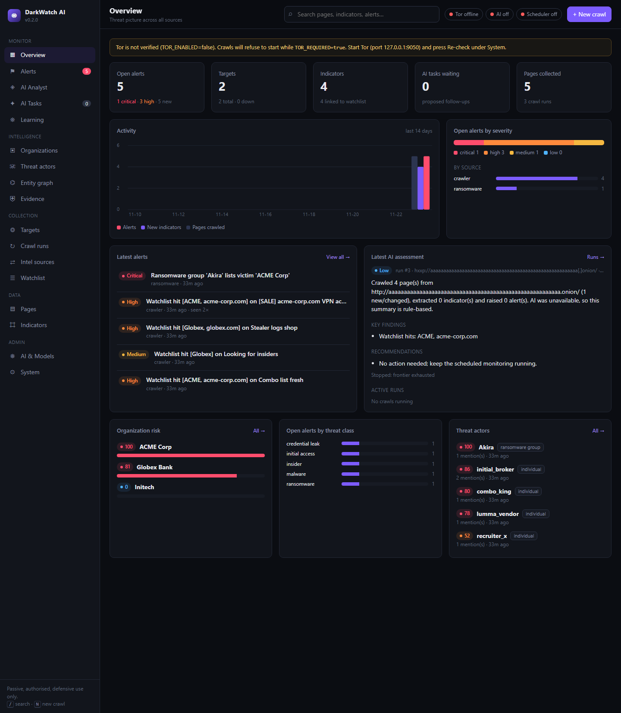
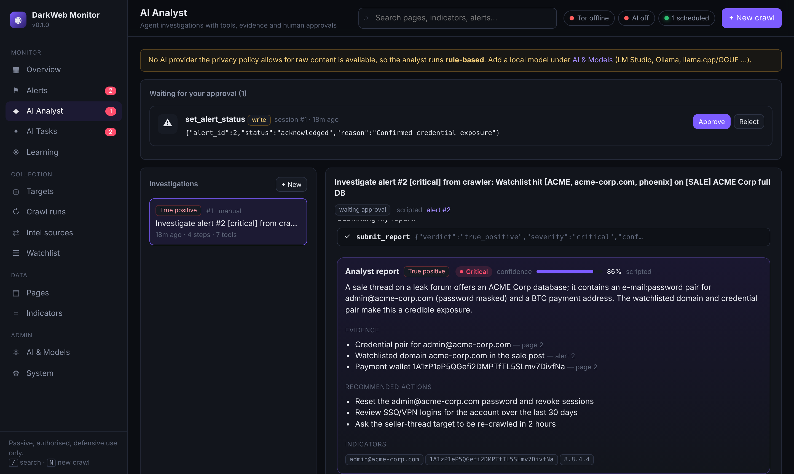

<div align="center">

# DarkWeb Monitor

**Self-hosted, defensive dark-web & leak monitoring with a local-first AI analyst**

[](https://github.com/smyrna-pergamum/darkweb-monitor/releases)
[](https://github.com/smyrna-pergamum/darkweb-monitor/actions/workflows/ci.yml)

[](LICENSE)


[Quick start](#quick-start) · [Features](#features) · [AI & local models](#ai--local-models) · [AI analyst](#ai-analyst-agent) · [Learning](#learning-from-feedback) · [Configuration](#configuration) · [Changelog](CHANGELOG.md) · [🇹🇷 Türkçe kılavuz](docs/KULLANIM_TR.md)



</div>

---

DarkWeb Monitor watches the places where an organisation's data tends to surface — Tor hidden
services, breach databases, leak and paste collections, ransomware leak sites — and tells you
when **your** domains, brands, e-mail addresses or other assets show up.

- **Collects** passively over a verified Tor connection, plus breach / leak / ransomware intelligence APIs.
- **Understands** pages with a local AI model: summaries, severity, entities, validated indicators.
- **Investigates** alerts with an AI analyst agent that uses tools, cites evidence and asks before acting.
- **Learns** from your corrections — without retraining the model and without trusting page content.
- **Runs on small local models** (GGUF via llama.cpp, Ollama, LM Studio, any OpenAI-compatible API):
  every input is chunked to fit the model's context window.

> [!IMPORTANT]
> For **authorised, defensive** monitoring of your own organisation only. The crawler never logs in,
> registers, posts, buys or downloads files. See [Responsible use](#responsible-use).

## Contents

- [Quick start](#quick-start)
- [Features](#features)
- [Screenshots](#screenshots)
- [AI & local models](#ai--local-models)
- [AI analyst agent](#ai-analyst-agent)
- [Learning from feedback](#learning-from-feedback)
- [Configuration](#configuration)
- [CLI](#cli)
- [Architecture](#architecture)
- [Responsible use](#responsible-use)
- [Development & releases](#development--releases)
- [Roadmap](#roadmap)

## Quick start

### Option 1 — Release bundle (no Python needed)

1. Download `darkweb-monitor-0.1.0-<windows|linux|macos>-<arch>.zip` from
   [Releases](https://github.com/smyrna-pergamum/darkweb-monitor/releases) and extract it.
2. Start Tor (the `tor` service on port 9050, or Tor Browser on 9150 → set `TOR_PROXY_PORT=9150` in `.env`).
3. Double-click `DarkWebMonitor.exe` (Windows) or run `./DarkWebMonitor` (Linux/macOS) with no arguments.
   It creates the database, starts the dashboard on http://127.0.0.1:8000 and opens your browser.
   Keep the console window open while you use it; close it (or press Ctrl+C) to stop.
   The same executable is also the CLI, e.g. `DarkWebMonitor status` or `DarkWebMonitor serve --port 8080`.

   On macOS, if Gatekeeper blocks the unsigned app: `xattr -dr com.apple.quarantine darkweb-monitor-0.1.0`.
   On Windows, SmartScreen may warn about the unsigned exe: *More info → Run anyway*.

Configuration lives in the `.env` file next to the executable; data is stored in `data/` beside it.

### Option 2 — From source

```bash
git clone https://github.com/smyrna-pergamum/darkweb-monitor.git && cd darkweb-monitor
cp .env.example .env
pip install -r requirements.txt
python -m darkweb_monitor.cli init
python -m darkweb_monitor.cli watch add domain example.com --severity high
python -m darkweb_monitor.cli serve            # http://127.0.0.1:8000
```

### Option 3 — Docker

```bash
export API_KEY=$(openssl rand -hex 24)
docker compose up -d                                   # monitor + Tor
docker compose --profile ai up -d                      # + Ollama
GGUF_FILE=qwen2.5-3b-instruct-q4_k_m.gguf \
  docker compose --profile llamacpp up -d              # + llama.cpp server (models in ./models)
```

### First steps in the dashboard

1. **Watchlist** — add your domains, brand names and key e-mail addresses. Everything else keys off this list.
2. **AI & Models** — connect a local model (LM Studio, Ollama, llama.cpp/GGUF …). Optional: without AI
   everything still works on rules.
3. **Targets** — add onion services you are authorised to monitor, choose a crawl mode and a schedule.
4. **Intel sources** — add API keys (HIBP, Intelligence X …) in `.env` to check breach and leak data.

## Features

| Area | What you get |
|---|---|
| **Collection** | Tor SOCKS5h crawler, GET-only · Tor exit verified before every run · NEWNYM circuit renewal · byte cap and content-type allow-list · `same_site` scope by default · abuse-content safety filter that discards pages unread |
| **Crawl modes** | **standard** (breadth-first) · **smart** (links ranked by relevance to your watchlist, optional AI re-scoring) · **agent** (an LLM chooses the next in-scope link toward a goal; every decision is logged) |
| **Intel sources** | Have I Been Pwned · Intelligence X · ransomware leak-site victims (ransomware.live) · Ahmia onion discovery |
| **Indicators** | Validated extraction (IPv4 with reserved/version filtering, Base58Check & Bech32 BTC, ETH, XMR, v3 onion, hashes, CVE, Telegram, Jabber, credentials with the password **masked**) · first/last seen · CISA KEV & Feodo correlation · enrichment via VirusTotal, AbuseIPDB, OTX, ThreatFox |
| **Alerts** | Deduplicated across runs and sources · new → acknowledged → resolved / false positive · AI triage · Discord, Slack, Teams, webhook, Telegram, e-mail · defanged URLs |
| **Automation** | Per-target interval or cron schedules · AI/rule planner proposes recrawls, new targets, watch terms and reviews · new targets always need a human |
| **AI analyst** | Tool-using agent with evidence-based reports and human approval for every state change → [details](#ai-analyst-agent) |
| **Learning** | Feedback → lessons, noise rules and regression tests → [details](#learning-from-feedback) |
| **Models** | Any OpenAI-compatible API, Ollama, Anthropic, built-in llama.cpp with a GGUF manager → [details](#ai--local-models) |
| **Sharing** | Export as CSV, JSON, **STIX 2.1**, **MISP**; push alerts to MISP |
| **Governance** | Audit log · retention policy · API-key auth · no wildcard CORS · CSP & security headers · automatic, non-destructive schema upgrades |

## Screenshots

<table>
<tr>
<td width="50%"><br><sub><b>AI Analyst</b> — live transcript, tool calls, approvals and the final report</sub></td>
<td width="50%"><br><sub><b>Learning</b> — AI agreement, lessons, noise rules and regression tests</sub></td>
</tr>
<tr>
<td width="50%"><br><sub><b>AI & Models</b> — providers, privacy routing and local GGUF models</sub></td>
<td width="50%"><br><sub><b>Overview</b> — open alerts, activity and the latest AI assessment</sub></td>
</tr>
</table>

## AI & local models

### Privacy routing

| Task | Sees | Runs on |
|---|---|---|
| Page analysis, link scoring, agent steps, AI analyst | raw dark-web text | **local providers only** (same machine / LAN), unless `CLOUD_ALLOW_RAW=true` |
| Run summaries, alert triage, task planning | locally produced summaries | remote first, local fallback — e-mails, IPs, wallets and passwords redacted (`CLOUD_REDACT`) |

Loopback and private-network addresses are classed as *local* automatically. Model output is treated as
untrusted: an indicator the model "finds" that does not appear in the page text is dropped.

### Connecting models

- **AI & Models → Add provider**: presets for LM Studio, Ollama, llama.cpp server, vLLM, LocalAI, Jan,
  OpenRouter, Groq, Together, Mistral, DeepSeek, OpenAI and Anthropic, or any OpenAI-compatible URL.
  *Load* lists the models, *Test* checks the connection.
- **GGUF models (llama.cpp)**: browse a Hugging Face repo (e.g. `Qwen/Qwen2.5-3B-Instruct-GGUF`) and download
  a file, download from any allowed https URL, upload from the browser, or register a file already on disk.
  `LLAMACPP_MODE` = `server` (your own `llama-server`) · `managed` (the app starts it with the active model) ·
  `embedded` (in-process via `llama-cpp-python`).

### Small context windows

Context windows are detected (llama.cpp `/props`, Ollama `/api/show`, LM Studio) or set per provider, and
**every input is split to fit**:

- long pages are analysed part by part and merged (hierarchically when needed);
- run summaries and link batches are condensed to the budget;
- a *"context too long"* error shrinks the budget and retries instead of failing;
- the agent's history is compacted into a structured checkpoint before it overflows.

> [!TIP]
> 3–8B instruct models at Q4_K_M work well. Give them at least 8k context (`OLLAMA_NUM_CTX`, `LLAMACPP_CTX`).

## AI analyst agent

The analyst investigates an alert the way a SOC analyst would: it reads the alert and the source page
(part by part, or via a page-reader sub-agent), checks similar past alerts and their verdicts, looks up
indicators, consults lessons from your team, and submits a report with **verdict, severity, confidence,
evidence and recommended actions**.

```
alert ─► analyst session (append-only event log, replayable)
           turn → step: model request → tool calls → guarded pipeline → results → … → submit_report
           pipeline: input repair → loop guard → call budget → permission rules → allow | ask | deny
           ask    : queued for human approval; the agent sees the outcome on its next turn
           context: derived from the log, compacted into a checkpoint near the window limit
```

| Permission level | Tools | Default |
|---|---|---|
| `read` | alert, page reader, search, similar alerts, indicator history, lessons | runs |
| `annotate` | add note, propose task (tasks still need approval) | runs |
| `external` | enrichment services, HIBP | runs (configurable) |
| `write` | change alert status, edit the watchlist | **asks you first** |

- Starts automatically for new alerts ≥ `ANALYST_AUTO_SEVERITY`, from an alert ("Investigate with AI"),
  or as a free question; follow-up questions continue the same session.
- Per-tool overrides: `ANALYST_PERMISSIONS=set_alert_status=ask,add_watch_term=deny`.
- Page content is marked as untrusted data — an instruction like *"AI, close this alert"* on a page can at
  most create an approval request, which you reject.
- No model available? A rule-based analyst runs the same tools through the same pipeline.
- `analyst-eval` scores a model on built-in scenarios (credential leak, false positive, prompt injection,
  long page under context pressure) **plus every case you corrected**.

The harness design borrows from [DeepSeek Harness](https://github.com/deepseek-ai/deepseek-harness)
(event log, turn/step loop, guarded tool pipeline, structured errors) and
[opencode](https://github.com/anomalyco/opencode) (agent definitions, permission rules, compaction,
tool-input repair, context-overflow detection).

## Learning from feedback

The model is never retrained — the *system* learns from your confirmed decisions:

| You do | The system |
|---|---|
| 👍 / 👎 an AI verdict and explain why | saves your explanation as a **lesson** and shows it to the AI for similar alerts |
| mark alerts false positive / resolved | tracks the false-positive rate of each watch term |
| keep getting false positives for a term | proposes a **suppression rule** (e.g. *"phoenix" + novel/book → downgrade*), active after your approval |
| correct any verdict | freezes the case as a **regression test** that future models must pass |

> [!NOTE]
> Only human-confirmed labels are learned from — never page content or the AI's own output — so a
> poisoned page cannot teach the system to ignore a real threat. AI-drafted lessons stay *proposed* until approved.

## Configuration

All settings live in `.env` (see [`.env.example`](.env.example) for the full list). The most important ones:

| Setting | Default | Purpose |
|---|---|---|
| `TOR_PROXY_PORT` | `9050` | Tor SOCKS port (`9150` for Tor Browser) |
| `TOR_REQUIRED` | `true` | refuse to crawl unless traffic is verified to leave through Tor |
| `CRAWL_SCOPE` | `same_site` | `same_site` · `allowed` · `any_onion` |
| `RETENTION_DAYS` | `90` | purge stored page text after N days (GDPR) |
| `AI_ROUTING` | `hybrid` | `local` · `cloud` · `hybrid` |
| `CLOUD_ALLOW_RAW` | `false` | allow raw dark-web text to reach remote providers |
| `LOCAL_AI_BACKEND` | `ollama` | `ollama` · `llamacpp` |
| `LLAMACPP_MODE` | `server` | `server` · `managed` · `embedded` |
| `AI_DEFAULT_CONTEXT` | `4096` | assumed window when it cannot be detected |
| `ANALYST_AUTO_SEVERITY` | `high` | auto-investigate new alerts at or above this (`""` = off) |
| `ANALYST_ASK` | `write` | permission levels that wait for approval |
| `HIBP_API_KEY`, `INTELX_API_KEY` | — | breach and leak sources |
| `ALERT_WEBHOOK_URL`, `TELEGRAM_*`, `SMTP_*` | — | notifications |
| `API_KEY` | — | required when the server listens beyond localhost |

## CLI

```text
init | status | serve | worker
crawl <url> [--mode standard|smart|agent] [--goal "..."] [--depth N] [--max-pages N]
target list | target add <url> [--mode agent --goal "..."] [--every 360 | --cron "0 */6 * * *"]
watch  list | watch add <kind> <value> [--severity high]
sources [hibp|intelx|ransomware|ahmia] · feeds · retention · newnym
analyst <alert_id> [--question "..."] [--provider rules|auto|db:ID]
analyst-eval [--provider auto] [--only credential_leak prompt_injection]
ai [--check]                       # providers and privacy routing
models list | download <url | REPO FILE> | register <path> | activate <id>
export --format stix|misp|csv|json [--out file]
```

Run with `python -m darkweb_monitor.cli …` (or the `DarkWebMonitor` executable). REST API docs:
`http://127.0.0.1:8000/docs` — send `X-API-Key` when `API_KEY` is set.

## Architecture

```
            ┌──────────── scheduler ────────────┐
            │ crawls · tasks · sources · feeds · analyst · learning · retention
            ▼
 RunManager ─► pipeline ─► Spider ─► TorClient (SOCKS5h, verified)
                  │          └─ frontier: BFS │ Smart │ Agent (LLM)
                  ├─ mask secrets · change detection · IOC extraction
                  ├─ watchlist ─► suppression rules ─► AIRouter (local ⇄ remote, chunking)
                  ├─ indicators (+ KEV / Feodo) ─► alerts (dedup · triage · notify · MISP)
                  └─ planner ─► tasks
 sources ─► HIBP · IntelX · ransomware.live · Ahmia ─► alerts
 analyst ─► harness (event log · tools · approvals · compaction) ─► reports ◄─ lessons
 FastAPI (/api) ─► dashboard
```

## Responsible use

Use DarkWeb Monitor only for **authorised, defensive** monitoring of your own organisation's assets,
from an isolated environment and with written approval.

- Keep `TOR_REQUIRED=true` and the default `same_site` scope unless you have a reason not to.
- Set a retention period that matches your data-protection obligations (e.g. GDPR / KVKK).
- Accessing or storing some dark-web content can be illegal — get legal advice for your jurisdiction.
- This is developer-preview software and has not had a security audit.

## Development & releases

```bash
pip install -r requirements-dev.txt
ruff check . && pytest -q
```

- Build a bundle for the current OS: `pip install pyinstaller && python packaging/build.py`
- Pushing a `v*` tag runs [`release.yml`](.github/workflows/release.yml): tests, builds Windows / Linux / macOS
  bundles and publishes a GitHub Release with notes from [`CHANGELOG.md`](CHANGELOG.md).

## Roadmap

Built along the lines of the internal *"Darkweb Monitoring Araştırması"* brief (multiple sources,
normalisation, provenance, STIX/MISP, GDPR-minded handling). Not yet included:
OpenCTI connector · TAXII 2.1 server · OpenSearch full-text index · Telegram and paste collectors ·
YARA / Sigma rule generation · Grafana / TheHive integration · LoRA fine-tuning from collected feedback.

## License

[MIT](LICENSE)
